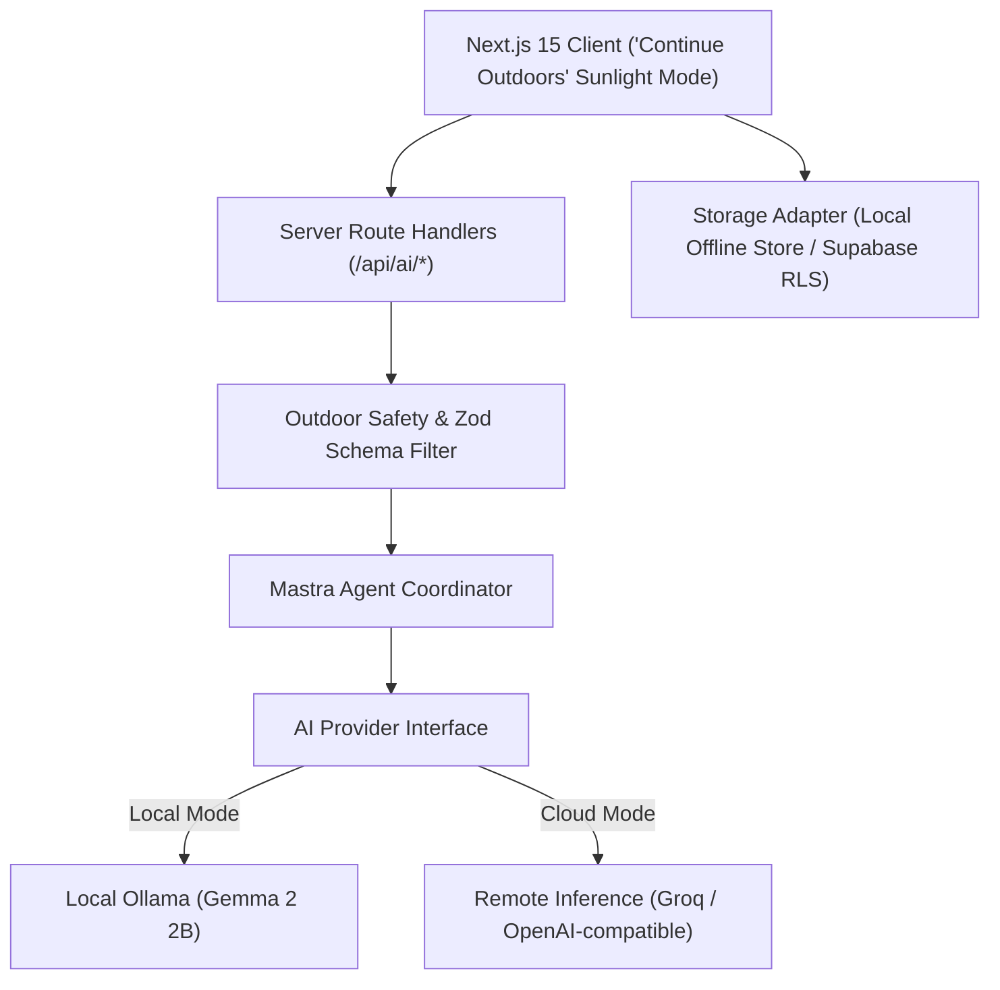

This is a submission for the [Hacktoberfest Open-Source AI Challenge Week 1: Touch Grass](https://dev.to/challenges/hacktoberfest-week1-2026-10-05)

## What I Built

Most AI products are designed to capture your attention and keep you staring at a glowing rectangle. They give you instant, authoritative-sounding answers so you never have to leave your chair.

I wanted to build the opposite.

**Mundane** is an open-source AI field investigator that turns everyday outdoor observations into small, structured scientific inquiries. Instead of acting like an encyclopedia that dispenses prefabricated trivia, it acts like a curious field biologist walking alongside you. Its job is to help you notice physical reality, record empirical clues, evaluate competing hypotheses, and return with a deeper understanding of the world.

### How It Works in Practice

Imagine you are walking down your street and notice something ordinary: small green rosettes of broadleaf plantain are flourishing along one narrow seam in the concrete sidewalk, but the parallel seam two feet away is completely bare.

When you enter this observation into Mundane (or snap a photo and note that it rained yesterday):

1. **Investigation Formulation**: The system generates a structured inquiry titled *"Pavement Fracture Botany"*, articulating a central question, observable physical phenomena to look for, and a safe, practical field procedure.
2. **"Continue Outdoors" Mode**: The interface switches to a high-contrast, distraction-free view designed to remain legible under direct sunlight. Crucially, each step explicitly instructs you to put your phone in your pocket, step back, and inspect the physical environment.
3. **Clue Collection & Grounded Breakdown**: When you record what you see—such as fine grit packed into the vegetated crack, or tire scuff marks near the bare seam—the AI doesn't just guess what's happening. It separates your notes into five rigorous categories:
   - Tangible, observable facts
   - Reasonable deductions
   - Competing alternative explanations
   - Questions that remain unanswerable without microscopic or laboratory assays
   - Safe next outdoor checks
4. **Hypothesis Testing Matrix**: You form a hypothesis (e.g., *"The plant flourishes because foot traffic compaction keeps moisture from evaporating quickly"*). The system compares your gathered field clues against this and alternative explanations (such as micro-topography runoff or seed dispersal shadows), grading them as *Supported*, *Plausible but Unverified*, *Inconclusive*, or *Contradicted*.
5. **Field Journal Dossier**: Once complete, the investigation is archived into a persistent naturalist journal with explicit uncertainty ratings, your personal reflections, and a one-click Markdown export.

Mundane never presents an AI guess as a scientifically established fact. If a question cannot be resolved with the naked eye, the application explicitly says so.

## Demo

- **Repository**: [https://github.com/Shade555/Mundane](https://github.com/Shade555/Mundane)
- **Live Deployment**: [https://mundane.onrender.com](https://mundane.onrender.com) *(Hosted on Render)*

### Running 100% Locally

If you want to run Mundane completely offline on your own machine without sending a single byte to an external server:

```bash
# 1. Pull the open-weight Gemma model via Ollama
ollama pull gemma2:2b

# 2. Clone the repository and install dependencies
git clone https://github.com/Shade555/Mundane.git
cd Mundane
npm install

# 3. Launch the local field desk
npm run dev
```

Open `http://localhost:3000` and the app will detect your local Ollama instance automatically.

## Code

The complete source code is open source under the Apache 2.0 license on GitHub:

👉 **[github.com/Shade555/Mundane](https://github.com/Shade555/Mundane)**

### Core Separation of Observation and Hypothesis

One of the central design challenges was preventing the AI from hallucinating definitive conclusions when looking at ambiguous real-world phenomena. To enforce scientific discipline, every observation passes through a strict Zod schema before reaching the user:

```typescript
// src/lib/ai/schemas/investigation.ts
export const ObservationAnalysisSchema = z.object({
  directlyObservableEvidence: z.array(z.string()).describe(
    "Tangible, physical facts verified with the naked eye (colors, textures, moisture, orientation)."
  ),
  reasonableDeductions: z.array(z.string()).describe(
    "Logical inferences derived directly from the observed evidence."
  ),
  alternativeExplanations: z.array(z.string()).describe(
    "Other plausible reasons for the observed phenomenon."
  ),
  cannotBeDeterminedWithoutLab: z.array(z.string()).describe(
    "Questions requiring soil chemical testing, microscopic analysis, or longitudinal observation."
  ),
  recommendedNextFieldCheck: z.string().describe(
    "A practical, safe outdoor action the user can do right now to gather more clarity."
  ),
});
```

Combined with a deterministic safety validator that intercepts any instructions encouraging tasting wild plants, handling unknown fungi, disturbing wildlife, or trespassing, this ensures the system remains both safe and intellectually honest.

## How I Built It

Mundane is built around a clean, decoupled architecture where the user experience, AI inference, and persistence layers remain independent.



### The Tech Stack

- **Frontend & App Framework**: Next.js 15 (App Router) with TypeScript and Tailwind CSS. The UI uses an earth-toned, editorial color palette (`paper`, `forest`, `charcoal`, `botanical`) designed specifically for readability outdoors.
- **Open-Weight AI Models**: Google Gemma 2 (`gemma2:2b` for fast, low-latency reasoning on standard CPUs) and Gemma multimodal (`gemma4:12b` for photo analysis).
- **Inference Runtime**: Ollama as the local runtime, connected via a configurable provider interface (`src/lib/ai/providers/ollama-provider.ts`). When deployed to the cloud, the provider automatically speaks standard OpenAI-compatible wire format (tested with Groq hosting open-weight models like Qwen and Llama 3.3).
- **Agent Orchestration**: `@mastra/core` coordinates the investigation synthesis, evaluating multi-hypothesis matrices and calibrating uncertainty ratings.
- **Storage Layer**: Dual-mode storage adapter. By default, it operates 100% offline using the browser's local storage and in-memory store. When cloud sync is desired, it synchronizes with Supabase PostgreSQL protected by Row Level Security (RLS) migrations.
- **Hosting**: Configured for Render as a Web Service (`render.yaml`) with full multi-stage Docker support.

### Engineering Challenges & Trade-offs

#### 1. The CPU Latency Problem on Local Hardware
Initially, I tested running a larger 12B model (`gemma4:12b`) for all text operations locally on my laptop. Because inference was executing on consumer CPU threads without a dedicated workstation GPU, each generation took between 90 and 180 seconds. Sitting on a park bench waiting three minutes for a response completely broke the user experience.

Switching text reasoning to `gemma2:2b` dropped response times to ~12–18 seconds while maintaining strict JSON grammar adherence. This taught me an important lesson: in an outdoor context where the user should be looking at trees rather than waiting for a spinner, a well-prompted small model beats an unwieldy large model every time.

#### 2. Cross-Platform Module Resolution on Linux Containers
During deployment to Render, the Next.js production build succeeded locally on Windows but failed on Render's Linux environment with `Module not found: Can't resolve '@/lib/db'`. Because Windows is case-insensitive, subtle bundler alias quirks in Next.js client components were masked locally. Resolving this required configuring explicit Webpack path mappings in `next.config.ts` and establishing deterministic relative imports for runtime instances.

## Why Does Open Innovation Matter?

Open-source and open-weight AI is not just a philosophical preference for Mundane; it is the reason the application can exist in the form it does.

1. **True Privacy for Field Observations**: When someone uses an app to document their daily walks, they are recording where they spend time, what they notice near their home, and potentially uploading photos of their immediate surroundings. With closed, commercial APIs, that personal behavioral data is routinely routed through proprietary servers and retained for corporate training. With open-weight models running on Ollama, every observation, photo, and reflection stays on the user's physical machine.
2. **Off-Grid, Signal-Free Autonomy**: Nature reserves, coastal trails, and rural woods rarely have reliable 5G connections. Proprietary API-dependent apps simply stop working the moment you cross the tree line. An open-weight model executing locally doesn't need an internet connection, an active subscription, or an API credit balance.
3. **Model Substitutability Without Vendor Lock-In**: Because the inference layer targets an open runtime rather than proprietary SDKs, users and developers can swap models as hardware allows—running `gemma2:2b` on a modest laptop, a quantized Qwen model on an edge device, or a 70B parameter model on a local workstation.
4. **Open Weights vs. Open Source**: It is important to be clear about licensing terms. Google's Gemma models are distributed as *open weights* under the Gemma Terms of Use (permitting commercial and research applications), while the Mundane application code is licensed under the OSI-approved Apache 2.0 license. Open innovation allows these two ecosystems to complement each other effectively.

## My Agent Session

This project was built with an agentic pair-programming workflow in Google Antigravity. Automated test runs (all 27 tests passing across safety checks, JSON extraction, schemas, storage adapters, and end-to-end inference workflows) and iterative debugging logs were maintained throughout development.

To view or import the corresponding DevRelay agent transcript:
- Developers using the DevRelay CLI can inspect and submit development logs using `devrelay sessions submit`.
- If you have an active DevRelay account, sessions can be viewed directly in your DevRelay profile.

## Prize Categories

- **Best Use of Render**: Mundane is deployed as a production Web Service on Render (`render.yaml`), hosting the Next.js App Router frontend and server route coordinator with zero manual infrastructure configuration.
